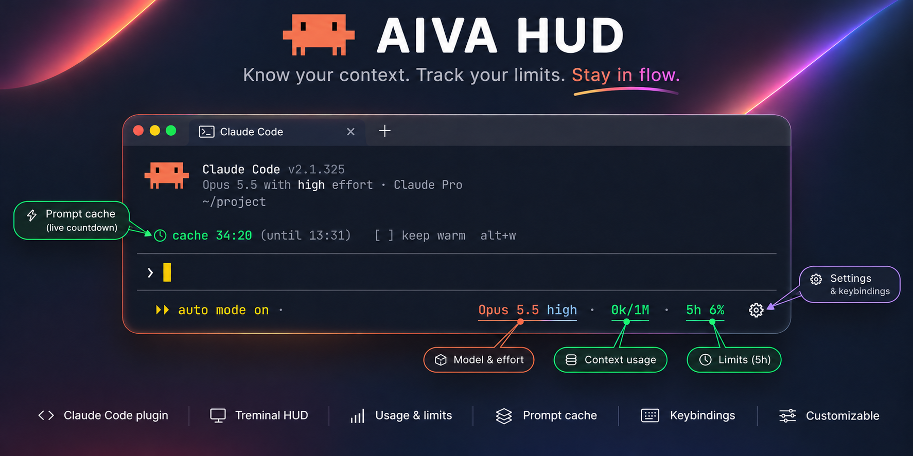

# AIVA HUD



Your model, context, and usage limits — right beside the **Claude Code** prompt. Install once and start with useful defaults.

[Install](#install) · [Settings](#settings) · [Clean prompt](#clean-prompt) · [Prompt cache](#prompt-cache) · [Context](#context) · [Limits](#limits) · [Guide](docs/guide.md)

## Install

Run at the **Claude Code prompt**:

```text
/plugin install aiva-hud --marketplace vfesenko94/aiva-hud
```

Confirm the marketplace with `y`, then press Enter for the default user scope. No separate API key or initial configuration needed.

Requires Claude Code with **TypeScript mods and native UI panes**, Git, and access to GitHub.

[Compatibility and installation](docs/guide.md#compatibility)

## See what matters

Model, reasoning effort, context usage, and the 5-hour limit are enabled by default. Readings appear as Claude Code supplies data, usually after a reply. The ordinary HUD makes no extra model requests.

| Click | What opens |
| --- | --- |
| **Model** | Open Claude Code's native `/model` selector. |
| **Effort** | Open the native `/effort` selector. |
| **Context**, e.g. `28k/1M` | Explore what fills your context window. |
| **5h** or **7d** | Check usage, reset times, and spending pace. |
| **⚙** or **`/aiva-hud`** | Customize the HUD. |

Use the mouse or keyboard; `Esc` goes back or closes a panel.

[Controls](docs/guide.md#controls)

## Settings

Choose which readings appear and how: short model names, context in tokens or percent, limits as usage or a reset countdown. Enable the optional **7-day** reading and set keyboard shortcuts.

**Live previews** show your changes. Display settings save automatically; new shortcuts require a restart.

[Settings guide](docs/guide.md#settings)

### Clean prompt

Open **⚙ → Hints** (or **`/aiva-hud` → Hints**) to hide individual Claude Code hints. Keep the ones you use and remove the visual clutter. Changes apply immediately.

For example, hide the mode-switch reminder and shortcut hint:

**Before**

```text
⏵⏵ auto mode on (shift+tab to cycle) · ? for shortcuts
```

**After**

```text
⏵⏵ auto mode on
```

You can also hide hints such as `ctrl+c to copy`, `↓ to manage`, and `/tasks to see subagents`.

[Hint settings](docs/guide.md#hints)

## Prompt cache

The idle timer estimates when your prompt cache will expire. Reusing cached input costs less than processing it again. After expiry, the next request loses that discount for the expired content, and rebuilding the cache has a write cost.

[Caching and pricing](https://platform.claude.com/docs/en/build-with-claude/prompt-caching)

Stepping away? For a **one-hour cache**, enable **keep warm** beside the timer to refresh it automatically. This experimental option makes extra model requests and uses quota. It is off by default and stops when you send your next message. The timer is an estimate; savings are not guaranteed.

[Cache guide](docs/guide.md#cache-timer)

## Context

Click the context counter to find the largest token contributors: instructions, tools, MCP content, skills, and recorded messages. Expand turns into model steps and tool calls to see where context grew, including recorded compactions.

History stays local and records while Context is enabled. Some token counts are estimates; they explain context usage rather than exact monetary cost or plan-quota consumption.

[Context guide](docs/guide.md#context-history)

## Limits

See **how much quota you have used**, when it resets, and whether your current pace is sustainable.

- **5 hours:** projects usage by reset and warns if your average pace would exhaust the limit. The estimate appears after the first 30 minutes.
- **7 days:** shows remaining quota and an approximate daily allowance until reset.

Limits are account-wide and can lag during long turns. Projections help you plan; they change with your workload.

[Limits guide](docs/guide.md#limits-and-estimates)

---

[Troubleshooting](docs/guide.md#troubleshooting) · [Update or uninstall](docs/guide.md#update-and-removal) · [Data and accuracy](docs/guide.md#data-and-accuracy) · [Contributing](CONTRIBUTING.md) · [Releases](CHANGELOG.md) · [Report an issue](https://github.com/vfesenko94/aiva-hud/issues) · [MIT](LICENSE)
